# An Ode to High Alpine Riding

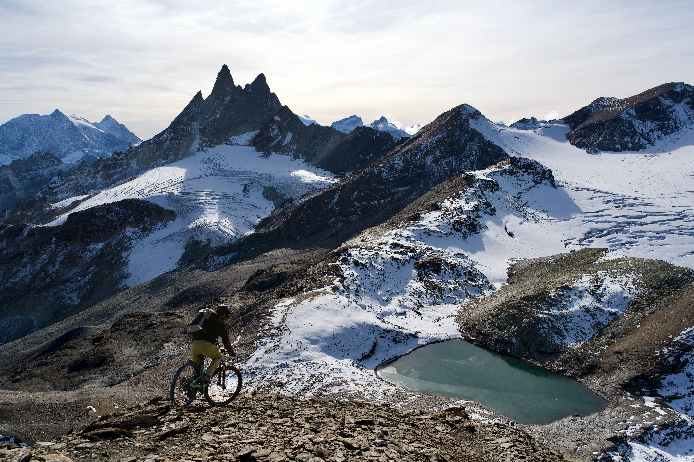
Words & Photos: **Nicolas Brunner **
Rider: **Reto Kurmann **

Mountainbiking season in the Alps climaxes very high during the last beautiful fall days. Those days where the colours of nature are the most intense with yellow, orange and even red tones. The skies are very clear and the air is fresh but does not make you freeze. And the mountains are not yet covered with heavy piles of snow. Those days, are simply put the best days of the riding season.

As I’m writing this, I’m on the train bringing me back home from an unforgettable riding day. It’s already dark outside and from time to time you can see the lights from our civilization passing by. I just had a beer together with a friend, soaking in memories and sharing emotions that we experienced during the last 12 hours. He’s now happily simmering away while I enjoy the silence to bring my thoughts to paper.

*Preparing adventures for the next year*

A day like today typically starts the winter before. When the early darkness of the night makes me stay at home in the evenings, I will sit in front of my computer looking at maps, photographs and reports from hiking forums. Sometimes, the topography and terrain drawn on a map will draw my attention and spark my imagination. It’s always hard to tell if a trail or terrain is rideable just by looking at a map or photographs. But it can catch my curiosity to go out there and see if it’s a great riding experience.

The European Alps are mostly less remote than the incredibly vast landscapes of the American continents. Mountainbike routes are well documented on the well-known platforms. And yet, there are many hidden gems waiting higher up in altitude. They require a little bit more effort to unlock, but will reward you with more adventure, solitude, breathtaking landscapes and sometimes incredible descents.

So, during those long winter nights, I will collect ideas, take notes and prepare a rough route. Adventures, ready to be taken out of the drawer when the window of opportunity opens up. Riding season in the high alpine is usually quite short. Depending on the snowfall in winter and the temperatures in late spring and early summer, the snowpack might only be gone by the end of July. August and September are usually fine, but the really best days will be in October, when winter hasn’t kicked in yet and nature is shining in its strongest colors. It’s always a bit of a lottery if we get gifted with those golden autumn days or not.

With a handful of ideas in my back pocket, we will block a few days in our calendar, where we could set out for adventure if the weather forecast is looking good a few days ahead. Higher up in altitude, it’s not just about sunshine and temperature, wind can become a huge factor too. Just as the exposition of a mountain does as well. If everything is looking good a few days ahead, it’s time to book the train and bus tickets for us and our bikes. Yes, we are very lucky with the public transport system in Switzerland. Don’t tell everyone, but there is basically a bus route up to every pass and valley. You could also call it a public shuttle system for cyclists. Apart from the environmental advantages of not having to rely on a car, there’s also the benefit of not limiting your route to end where it started.

I prefer to keep group size small. Just me and a dear friend that shares the same passion is best. With a bigger group you are slower and it’s harder to take decisions that work for everyone.. When preparing our packs, we will align and make sure not to carry equipment twice. Typically this means that my friend will carry repair and first-aid equipment while I bring the camera along.

This particular morning, we are eating our breakfast in the train and discussing the route options. Then, we take the bus up a small valley. The bus is crowded with hikers looking to enjoy this beautiful autumn day. After an hour, we reach the end of the valley and heft our bikes from the rack on the back of the bus. As the sun has not yet touched the valley floor this morning, we are quite happy to pedal a bit. 

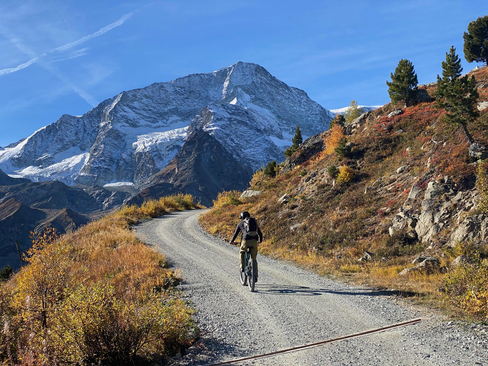
*The day starts with a fireroad climb and some doubts if the recent snowfalls might make us turn-around early.*

By the time the sun appears and starts to warm our bodies, we are already above the tree line. Today we seem to get lucky and there's plenty of rideable uphill sections. This is not the norm at this altitude.

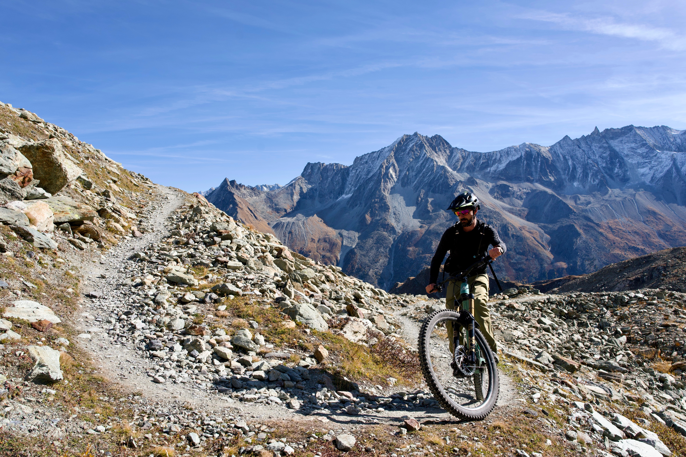
*Rideable uphill sections are not the norm in the alps.*
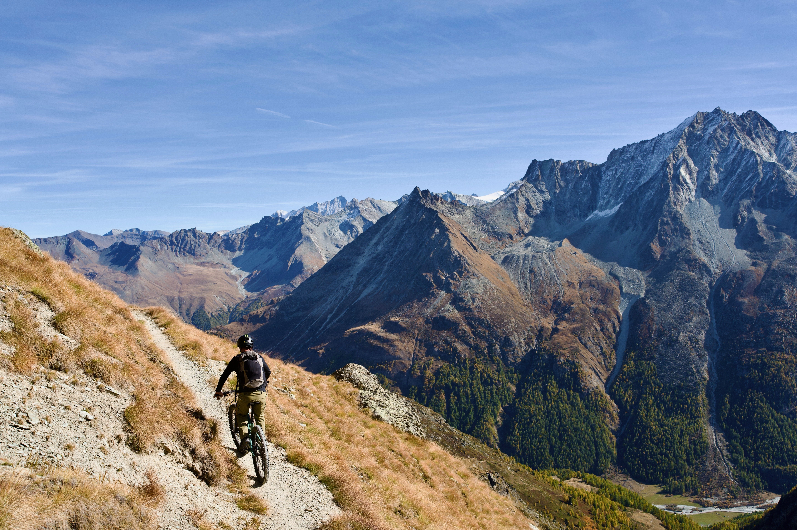
*Especially not if they're so smooth as today, that there's enough time to soak in the landscapes.*

After a few hours, we reach a mountain hut. There are many high mountain “bewirtet” huts like this in the Alps. Most of them were built a century ago with alpinists in mind, so they could start very early in the morning with their ascent. Today, they’re also a great option for multi-day adventures on a mountainbike and you’ll meet many like-minded people (though not many on a mountainbike). However this particular day, the hut is already closed for the winter season.

Leaning against the building and enjoying those autumn sun rays on our skin, we take a little break to eat something before we continue our way up.

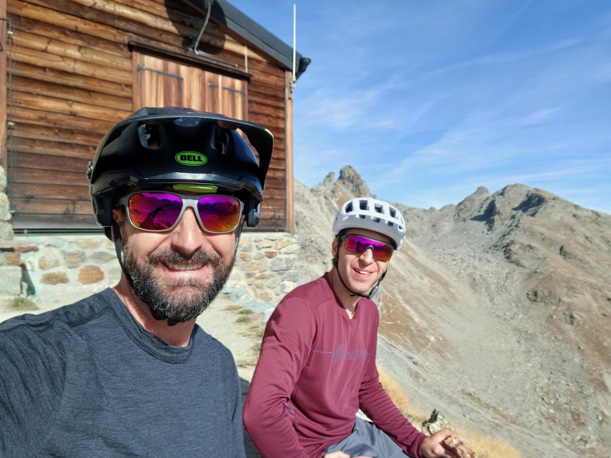
*Blurry selfie-time in front of the hut.*

The roles are going to change now and we start pushing or carrying the bike. There are no fireroads or rideable uphill trails at this altitude - at least if you want to save some energy. I know that for some, pushing the bike  [is the worst](https://nsmb.com/articles/push-bike) - but I really enjoy the calm nature of it. With every step I find it easier to get into a more meditative attitude and take the time to soak in the beautiful surroundings. Funnily, when pedaling we tend to stay together and have a conversation but with hiking we are both sticking to our own rhythm and thoughts. 

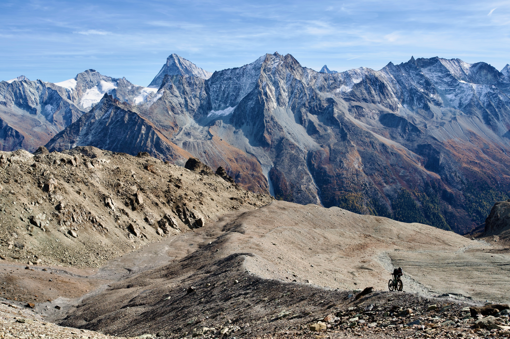
*Slowly making our way up a glacial moraine.*

I’m not going to lie - depending on the terrain, it can get exhausting and you’ll always question yourself if this is worth it. Especially in scree slopes, where every step upwards means sliding back half a step. It’s definitely not a race up here and we move slowly. Since today, the first part of the descent will be on the ascent route, we take our time to scout lines. Often they look worse and more frightening from below. 

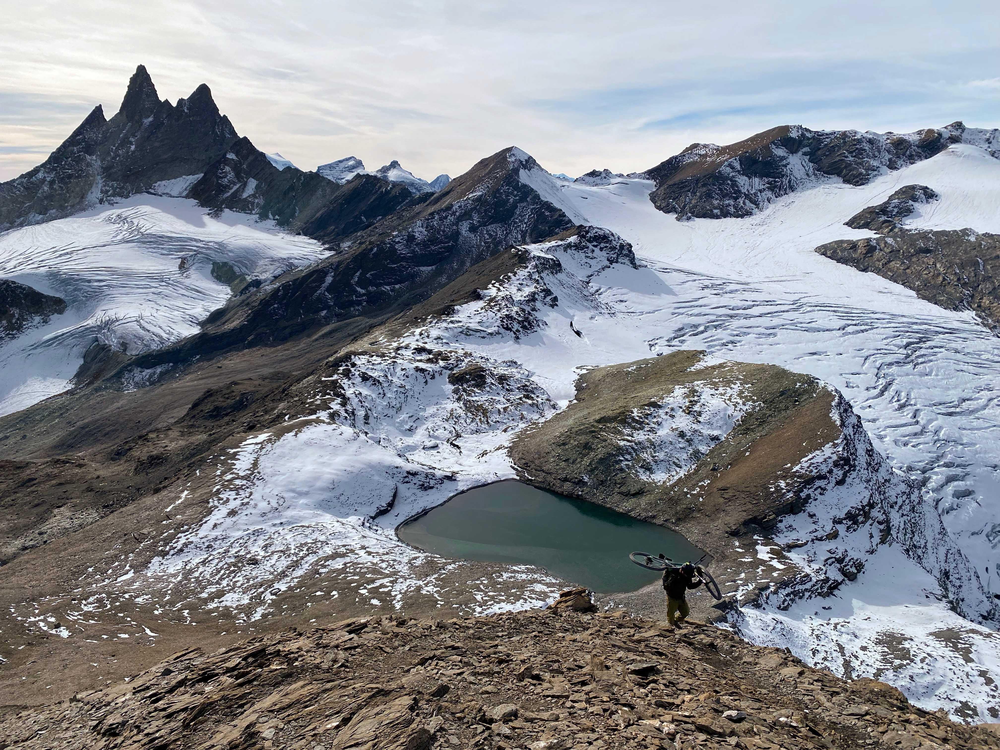
*And finally carrying our bikes. Who cares with such a view?*

There are days, where we will decide to leave our bikes behind at a certain point and continue on foot until the top. However, today is a good day and we can carry our bikes until shortly below the peak. The last 100 meters are on an exposed ridge line with a little bit of easy climbing involved and not mountainbiking territory.

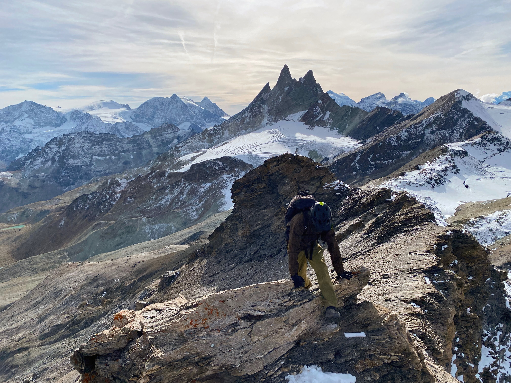
*Reaching the final peak on foot. If you watch closely, you can spot our bikes left behind.*

With the peak just a few steps away, I start experiencing an overwhelming feeling of joy. It’s partly relief that the harder parts are behind. The other part is this incredible feeling of being “on top” of the world. It makes me see things clearer, the small worries of life that make my mind wander around fade away and I just feel so alive. It’s a feeling I cannot get enough of. Sharing this feeling  after a lot of common suffering with someone you value and care for is one of the many pleasures of life. No need to exchange a lot of words. Just enjoying the moment in silence together.

And then there’s obviously the cherry on top: The descent. The excitement that the less fun part is behind us and that we’re about to descend 3000 vertical meters of epic singletrack is hard to describe. This thrill of anticipation is paired with some respect for the technicality of the terrain. There are days where I’ll easily find my flow and days where I’ll struggle a bit more to get into the zone. Being in such remote places always means, that I’m not riding on my limit and that I keep speeds low. Not having to worry about your friends either and trusting them to judge their abilities is essential.

*Dropping in for a long descent.*

Today the terrain will change quite a bit from top to bottom. We’re starting in a steepish rocky scree slope, playing with our brakes and finding the balance between our tires not washing out under us and keeping speed in check. Since we’re not exactly Gee Atherton, it’s more about the joy of riding in such landscapes than the riding experience itself. The terrain is not very exposed today, but we still don’t want to fall in this steep rocky terrain.

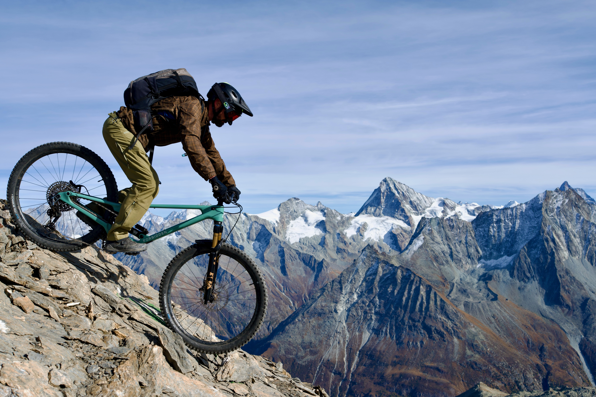
*Riding in the scree means grip can change anytime.*
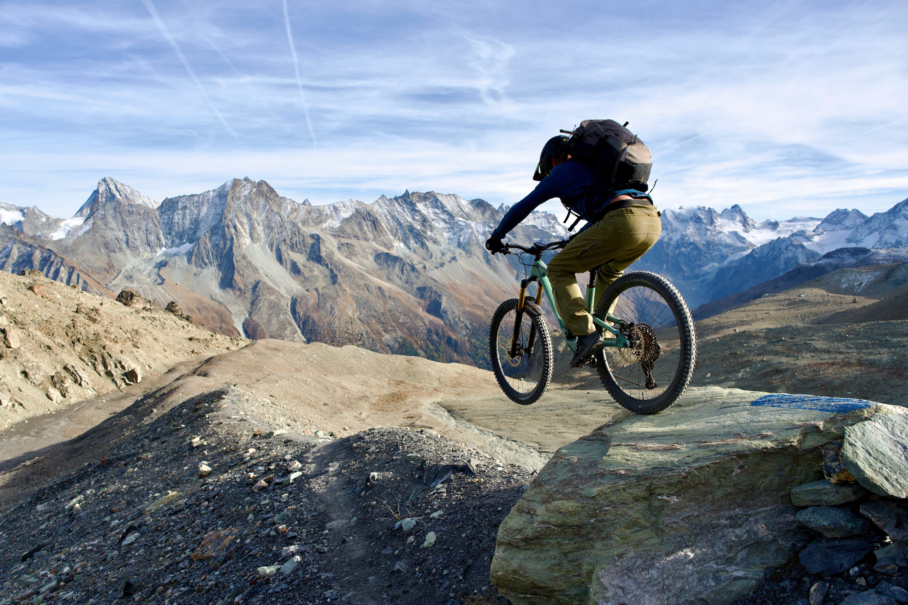
*There's little features to be found everywhere.*

After a while, we reach a small emerald blue lake and the nature of the trail starts changing. There’s some sparse vegetation here and there. The top-of-the-world feeling vanishes and the terrain gets more varied. The trail gets chunkier, which is a welcome change and allows our tires to finally find better braking traction. It’s a back-and-forth between slow-tech parts and faster flowier sections. We feel the need to stop from time to time, take in the wild fall colors from the bushes around us and also giving our legs and arms a little bit of rest.

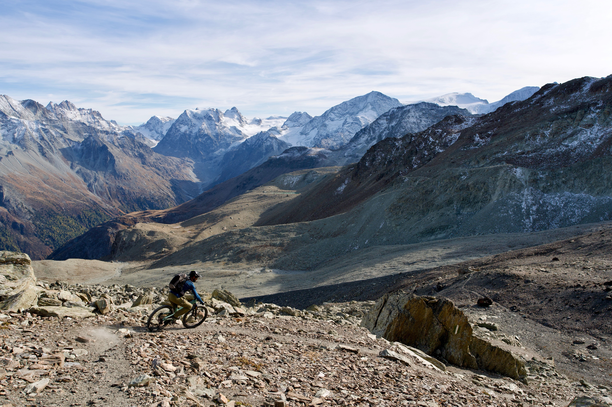
*Finally the terrain invites us to let go our brakes more.*

Then, we hit the tree-line and there’s another shift in riding terrain. It’s not without reason that forests are one of our favorite playgrounds. The trail gets loamier and there are roots inviting us to get some airtime after every corner. This is not a trail that sees a lot of usage and the bushes are brushing on the skin of our legs. The feeling of riding down a narrow trail that rarely sees any mountainbike tires but seems to be built for this sole purpose combined with the wild orange and yellow colors of the trees around us is quite incredible. In terms of pure riding, this is where it’s at its best.

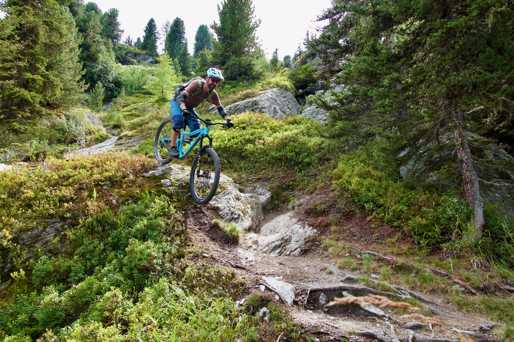
*Different vibes below the tree line. You might notice the different bike. This image is from another day, since we were in a hurry to catch our bus.*

Completely washed but flooded with endorphins we reach the valley floor and pedal down to the nearest bus station. The local bakery is still open and we can grab some local pastries before loading our bikes on the bus.

One hour later, here I am, sitting comfortably inside the cosy warm train taking us back home through the darkness outside. My hearth full of memories that will resonate for a very long time. Realizing, that there’s so much more to discover, if you push yourself just a little bit out of your comfort zone.

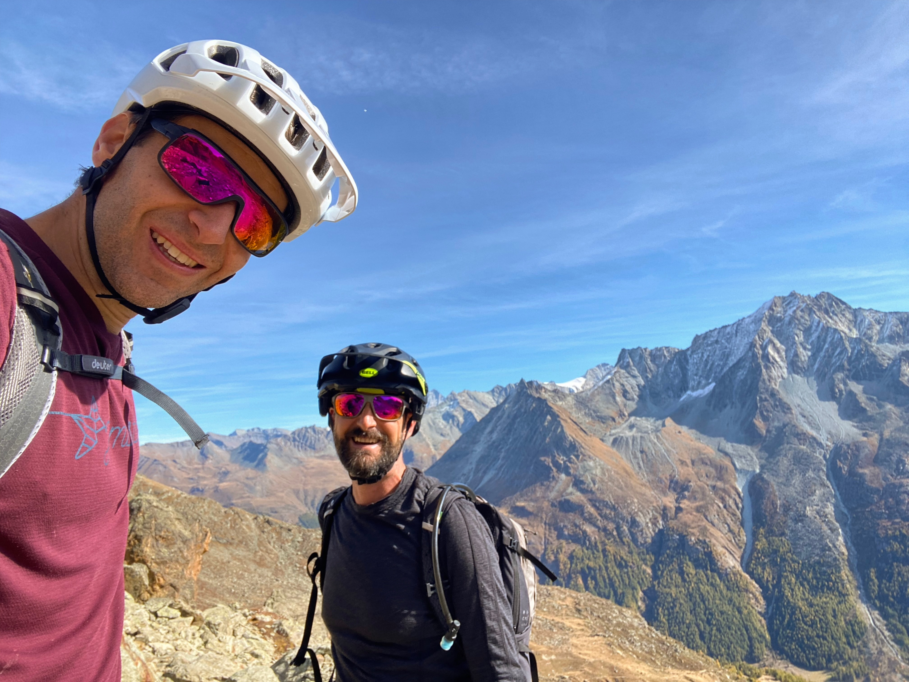
*Thank you Reto, that we can share our passion together. To many more!*
